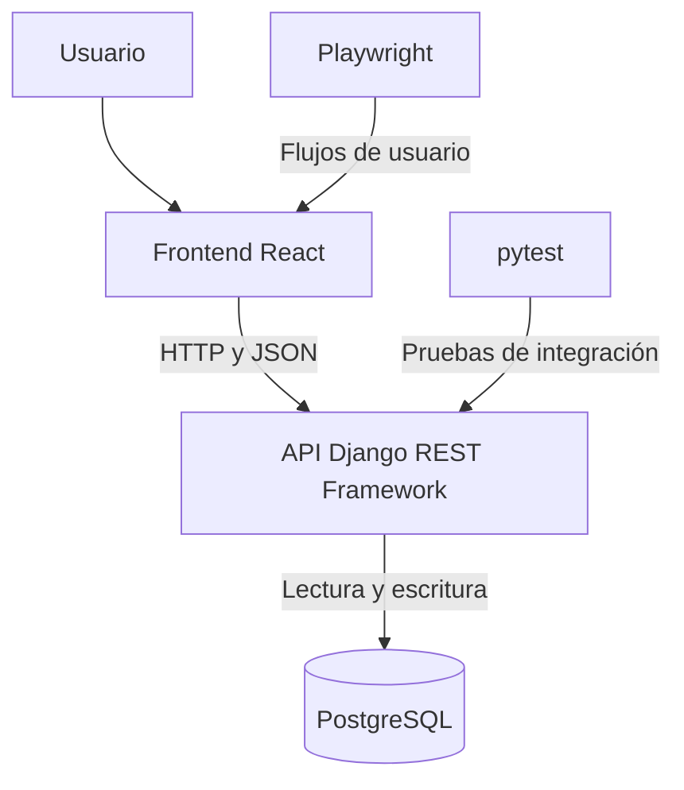
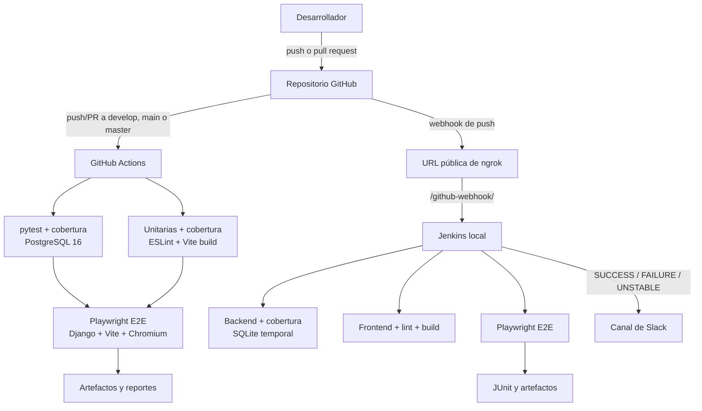

# CrowdStarter

Plataforma web de crowdfunding desarrollada para la asignatura **INF331 — Pruebas de Software** de la Universidad Técnica Federico Santa María.

## Objetivo

Desarrollar una plataforma que permita a los usuarios publicar y descubrir proyectos que buscan financiamiento.

El proyecto también busca aplicar prácticas de pruebas de software para verificar los requisitos, detectar errores y comprobar que las funcionalidades se mantienen después de integrar cambios.

## Alcance de la Entrega 1

La primera entrega implementa la gestión de usuarios y campañas:

- Registro de usuarios con validación de campos, mayoría de edad y duplicados.
- Inicio de sesión mediante correo electrónico y contraseña.
- Autenticación mediante tokens JWT.
- Creación y publicación de campañas.
- Visualización de campañas propias.
- Búsqueda por nombre, sin distinguir mayúsculas ni tildes.
- Consulta del detalle de una campaña.
- Edición y eliminación de campañas por su propietario.
- Confirmación antes de eliminar.
- Visualización de la meta y del progreso de financiamiento almacenado.
- Persistencia de datos en PostgreSQL.
- Interfaz adaptable a distintos tamaños de pantalla.

**Fuera del alcance actual:** procesamiento de pagos y registro de aportes monetarios reales. La visualización del progreso no implica que exista un flujo de donaciones implementado.

La búsqueda utiliza coincidencias de texto en el título; no implementa un motor de búsqueda semántica.

## Funcionalidades implementadas

| Funcionalidad | Descripción |
|---|---|
| Registro | Creación de cuentas con nombre de usuario, correo, contraseña y fecha de nacimiento |
| Inicio de sesión | Autenticación mediante correo y contraseña |
| Crear campaña | Publicación de una campaña con sus datos obligatorios e imagen opcional |
| Mis campañas | Listado de las campañas pertenecientes al usuario autenticado |
| Buscar campañas | Búsqueda por el nombre de una campaña |
| Ver detalle | Consulta de descripción, categoría, creador, meta, progreso y fecha límite |
| Editar campaña | Modificación de una campaña por su propietario |
| Eliminar campaña | Eliminación por su propietario, previa confirmación |

### CRUD de campañas

| Operación | Implementación |
|---|---|
| Create | Crear y publicar campañas |
| Read | Listar, buscar y consultar campañas |
| Update | Editar campañas propias |
| Delete | Eliminar campañas propias |

### Validaciones principales

- Campos obligatorios y formato del correo.
- Edad mínima de 18 años para registrarse.
- Rechazo de nombres de usuario y correos duplicados.
- Mensaje genérico ante credenciales incorrectas.
- Meta de financiamiento mayor que cero.
- Fecha límite igual o posterior al día actual.
- Verificación de propiedad para editar y eliminar campañas.

## Tecnologías

| Área | Tecnología | Propósito |
|---|---|---|
| Frontend | React + Vite | Interfaz y entorno de desarrollo |
| Navegación | React Router | Navegación entre vistas |
| Estilos | CSS y Tailwind CSS | Presentación visual |
| Backend | Django REST Framework | API REST y validación de datos |
| Base de datos | PostgreSQL | Persistencia |
| Autenticación | Simple JWT | Emisión y validación de tokens |
| Imágenes | Pillow | Soporte de imágenes en Django |
| Pruebas del backend | pytest + pytest-django | Pruebas de integración |
| Pruebas unitarias | Node.js Test Runner | Verificación aislada de la búsqueda |
| Pruebas E2E | Playwright | Verificación de flujos desde el navegador |
| Control de versiones | Git / GitHub | Ramas, revisión e integración de cambios |

La automatización de pruebas mediante GitHub Actions se contempla como mejora del proceso. La ejecución local se describe más adelante.

## Arquitectura general

React se comunica mediante HTTP con la API de Django REST Framework. El backend procesa las solicitudes, valida los datos y utiliza PostgreSQL para almacenarlos.



### Organización del proyecto

```text
api/
    models.py                 Modelos de datos
    serializers.py            Serialización y validaciones
    views.py                  Vistas de la API y permisos
    migrations/               Migraciones de la base de datos
    test_registro.py           Pruebas de registro
    test_login.py              Pruebas de autenticación
    test_campanias.py          Pruebas de campañas

config/
    settings.py               Configuración de Django
    urls.py                   Rutas de la API

frontend/
    src/                      Componentes, páginas y estilos
    tests/                    Pruebas de Playwright
    unit/                     Pruebas unitarias de búsqueda
    package.json              Dependencias y scripts
    package-lock.json         Versiones resueltas del frontend
    playwright.config.js      Configuración de pruebas E2E

docs/                         Documentación de funcionalidades y usabilidad
manage.py                     Administración de Django
requirements.txt              Dependencias de Python
```

## Instalación y ejecución local

### Requisitos previos

- Git.
- Python compatible con las dependencias de `requirements.txt`.
- Node.js y npm. En el desarrollo se utilizó Node.js 24.
- PostgreSQL instalado y en ejecución.

Cada computador necesita su propio entorno virtual y su configuración de PostgreSQL. Clonar el repositorio no transfiere bases de datos, cuentas, campañas ni imágenes cargadas en otro equipo.

### 1. Obtener el código

```bash
git clone https://github.com/IbenMG/Proyecto-PruebasdeSoftware.git
cd Proyecto-PruebasdeSoftware
git switch develop
```

Si el repositorio ya está clonado, comprobar primero que no existan cambios pendientes:

```bash
git status
git fetch origin
git switch develop
git pull --ff-only origin develop
```

### 2. Preparar PostgreSQL

Crear una base de datos llamada `crowdstarter` y asignarla al usuario que utilizará Django.

Desde una sesión administrativa de PostgreSQL, si el usuario ya existe:

```sql
CREATE DATABASE crowdstarter OWNER masteruser;
```

Si el usuario no existe, crearlo antes:

```sql
CREATE ROLE masteruser WITH LOGIN PASSWORD 'REEMPLAZAR_POR_CLAVE_LOCAL';
CREATE DATABASE crowdstarter OWNER masteruser;
```

Estos comandos se ejecutan una sola vez. Si la base y el usuario ya existen, no es necesario recrearlos.

Revisar el bloque `DATABASES` en `config/settings.py` y comprobar que el usuario, contraseña, host y puerto coincidan con la instalación local.

El nombre de la base se puede seleccionar mediante la variable de entorno `DB_NAME`. Las demás credenciales deben coincidir con la configuración del archivo.

> Las migraciones crean las tablas dentro de una base existente; no crean la base de datos PostgreSQL.

### 3. Backend en Windows

Desde la raíz del proyecto, en PowerShell:

```powershell
python -m venv .venv
.\.venv\Scripts\python.exe -m pip install -r requirements.txt

$env:DB_NAME = "crowdstarter"

.\.venv\Scripts\python.exe manage.py migrate
.\.venv\Scripts\python.exe manage.py runserver
```

No es necesario activar el entorno al utilizar directamente su ejecutable de Python.

### 4. Backend en Linux

Desde la raíz del proyecto:

```bash
python3 -m venv .venv
source .venv/bin/activate
python -m pip install -r requirements.txt

export DB_NAME=crowdstarter

python manage.py migrate
python manage.py runserver
```

En algunas distribuciones puede ser necesario instalar el paquete del sistema que proporciona `venv`.

La variable `DB_NAME` debe establecerse nuevamente al abrir otra terminal.

### 5. Frontend

Abrir otra terminal y entrar a `frontend`.

**Windows:**

```powershell
cd frontend
npm.cmd ci
npm.cmd run dev
```

**Linux:**

```bash
cd frontend
npm ci
npm run dev
```

Acceder a:

- Aplicación: http://localhost:5173
- Backend: http://127.0.0.1:8000

Mantener ambas terminales abiertas. Para detener los servidores, utilizar `Ctrl+C`.

En los siguientes arranques no es necesario reinstalar las dependencias, salvo que estas hayan cambiado.

## Estrategia de pruebas

Las pruebas se organizan a partir de las historias de usuario y sus criterios de aceptación.

| Nivel | Herramienta | Alcance |
|---|---|---|
| Unitarias | Node.js Test Runner | Función de búsqueda aislada |
| Integración | pytest + pytest-django | API, validaciones, permisos y persistencia |
| Extremo a extremo | Playwright | Flujos completos desde el navegador |

### Técnicas utilizadas

- **Particiones de equivalencia:** entradas válidas e inválidas, como correos correctos e incorrectos.
- **Valores límite:** mayoría de edad, meta monetaria y fecha límite.
- **Pruebas de permisos:** operaciones del propietario y rechazo de operaciones de otros usuarios.
- **Regresión:** repetición de pruebas después de integrar funcionalidades o modificar la interfaz.

Usar pytest no convierte automáticamente una prueba en unitaria. Las pruebas de la API se clasifican como integración porque involucran distintos componentes y una base de datos de pruebas.

### Pruebas unitarias de búsqueda

Se implementaron cuatro casos:

1. Coincidencia exacta antes de coincidencias parciales, contemplando mayúsculas y tildes.
2. Consulta vacía.
3. Consulta sin coincidencias.
4. Búsqueda limitada al título.

Desde `frontend`, en Windows o Linux:

```bash
node --test unit/buscarCampanias.test.js
```

No requieren backend, navegador ni base de datos.

### Pruebas de integración del backend

PostgreSQL debe estar funcionando. El usuario utilizado para las pruebas locales necesita permiso para crear la base de datos de pruebas.

Si falta ese permiso, un administrador de PostgreSQL puede otorgarlo al usuario local correspondiente:

```sql
ALTER ROLE masteruser CREATEDB;
```

**Windows, desde la raíz:**

```powershell
$env:DB_NAME = "crowdstarter"
.\.venv\Scripts\python.exe -m pytest api --ds=config.settings -v
```

**Linux, desde la raíz:**

```bash
source .venv/bin/activate
export DB_NAME=crowdstarter
python -m pytest api --ds=config.settings -v
```

Estas pruebas no necesitan `runserver`. pytest-django prepara una base de datos de pruebas separada.

El total actualizado de casos se muestra en la salida de pytest.

### Pruebas E2E

La suite funcional incluye 16 pruebas:

| Área | Cantidad |
|---|---:|
| Registro | 4 |
| Login | 3 |
| Campañas | 3 |
| Eliminación | 3 |
| Búsqueda | 3 |
| **Total** | **16** |

Para ejecutarlas:

1. Iniciar PostgreSQL.
2. Levantar Django en el puerto 8000.
3. Levantar Vite en el puerto 5173.
4. Ejecutar Playwright desde `frontend`.

#### Windows — Brave

Brave debe estar instalado en la ruta indicada en `playwright.config.js`.

```powershell
npx.cmd playwright test tests/registro.spec.js tests/login.spec.js tests/campanias.spec.js tests/busqueda.spec.js tests/eliminar.spec.js --project=brave --headed --workers=1 --reporter=list,html
```

Para abrir el reporte:

```powershell
npx.cmd playwright show-report
```

#### Linux — Chromium

El proyecto `brave` contiene una ruta de Windows. Para Linux se puede utilizar el proyecto `chromium`.

Instalar el navegador y sus dependencias:

```bash
npx playwright install --with-deps chromium
```

Ejecutar la suite:

```bash
npx playwright test tests/registro.spec.js tests/login.spec.js tests/campanias.spec.js tests/busqueda.spec.js tests/eliminar.spec.js --project=chromium --headed --workers=1 --reporter=list,html
```

Para abrir el reporte:

```bash
npx playwright show-report
```

La opción `--headed` muestra el navegador y requiere un entorno gráfico.

> Las pruebas E2E crean usuarios y campañas en el backend al que apuntan. Ejecutarlas en un entorno de desarrollo destinado a pruebas.

### Compilación del frontend

Desde `frontend`:

**Windows:**

```powershell
npm.cmd run build
```

**Linux:**

```bash
npm run build
```

## Integrantes

| Integrante | Rol académico | Responsabilidad principal |
|---|---|---|
| Benjamín Araos | 202273637-2  | Testing |
| Dan Gonzalez | 202273543-0 | Backend |
| Jaime Donoso | 202273645-3 | Frontend |
| Iben Muñoz | 202204674-0 | Full-stack |

Las responsabilidades principales no excluyen la colaboración en otras áreas del proyecto.

## Flujo de trabajo

- `main`: versiones estables destinadas a entrega.
- `develop`: integración del desarrollo.
- `feature/*`: funcionalidades y mejoras.
- Pull Requests para revisar e integrar los cambios.

Antes de integrar cambios, ejecutar las pruebas relacionadas y comprobar que las funcionalidades existentes continúen operativas.

## Documentación

- [Repositorio](https://github.com/IbenMG/Proyecto-PruebasdeSoftware)
- [Wiki](https://github.com/IbenMG/Proyecto-PruebasdeSoftware)
- [Releases](https://github.com/IbenMG/Proyecto-PruebasdeSoftware/releases)
- [Documentación del proyecto](docs/)
- [Decisiones de usabilidad](docs/usabilidad-interfaz.md)

**Video de la Entrega 1:** 
[video](https://usmcl-my.sharepoint.com/:v:/g/personal/iben_munoz_usm_cl/IQB4rWI5bBhDS6ayKutz5tzoAXQ0Ta8v61SwzMZj1dAdJJo?nav=eyJyZWZlcnJhbEluZm8iOnsicmVmZXJyYWxBcHAiOiJPbmVEcml2ZUZvckJ1c2luZXNzIiwicmVmZXJyYWxBcHBQbGF0Zm9ybSI6IldlYiIsInJlZmVycmFsTW9kZSI6InZpZXciLCJyZWZlcnJhbFZpZXciOiJNeUZpbGVzTGlua0NvcHkifX0&e=TPSdtb).

## Estado del desarrollo

### Entrega 1

- [x] Selección del tema y tecnologías.
- [x] Definición de requisitos e historias de usuario.
- [x] Configuración del repositorio y trabajo mediante ramas.
- [x] Configuración del backend, frontend y PostgreSQL.
- [x] Registro y autenticación.
- [x] CRUD de campañas.
- [x] Búsqueda y visualización de campañas propias.
- [x] Validaciones y permisos.
- [x] Pruebas unitarias, de integración y E2E.
- [x] Mejora visual de la interfaz.
- [x] Incorporar el enlace al video.
- [x] Confirmar la publicación de la release `v1.0-entrega1`.

***
### Entrega 2 — Integración y Entrega Continua de CrowdStarter

## 2. Objetivo de la Entrega 2

El objetivo de la Entrega 2 es incorporar un proceso de integración continua que valide automáticamente cada cambio relevante del proyecto. Antes de considerar aceptable una modificación, el pipeline comprueba el backend, el frontend, las reglas de calidad y los flujos completos de usuario.

Además, se implementó un flujo de entrega continua basado en artefactos. Cuando el pipeline termina correctamente, quedan disponibles el build del frontend y los reportes de pruebas y cobertura para una publicación posterior.

El alcance de esta entrega no incluye el despliegue automático de la aplicación en una plataforma cloud. Por lo tanto, el término CD se utiliza como entrega continua de artefactos preparados para desplegar, no como despliegue automático a producción.

Los objetivos concretos son:

- Detectar errores de forma temprana después de un `push` o pull request.
- Ejecutar las pruebas de manera repetible y aislada.
- Verificar cobertura, lint y compilación del frontend.
- Validar flujos reales mediante pruebas E2E.
- Conservar reportes y artefactos de cada ejecución.
- Notificar opcionalmente por Slack el resultado de Jenkins.
- Incorporar y validar dos nuevos requerimientos funcionales.

**Adicionalmente se adjunta video autoexplicativo como parte de la entrega 2**:
[Video autoexplicativo](https://drive.google.com/file/d/1DhhoYorLBMYnuGxOsrG8Hvt5eUWF34OX/view?usp=sharing "https://drive.google.com/file/d/1DhhoYorLBMYnuGxOsrG8Hvt5eUWF34OX/view?usp=sharing")

## 3. Qué se implementó

Para esta entrega se incorporaron los siguientes elementos:

- Un workflow de GitHub Actions en `.github/workflows/ci.yml`.
- Un pipeline declarativo de Jenkins en `Jenkinsfile`.
- Integración GitHub → Jenkins mediante webhook.
- Exposición temporal de Jenkins local mediante ngrok.
- Integración Jenkins → Slack mediante el plugin Slack Notification.
- Pruebas backend con pytest y cobertura.
- Pruebas unitarias frontend con cobertura.
- Validación de código con ESLint.
- Construcción del frontend con Vite.
- Pruebas E2E con Playwright y Chromium.
- Publicación de resultados JUnit y artefactos.
- HU06: hitos, checkpoints y metas graduales.
- HU07: muro de novedades y actualizaciones de campañas.

## 4. Arquitectura e infraestructura

### 4.1 Arquitectura general




### 4.2 Dónde corre Jenkins

Jenkins se ejecuta localmente. La configuración documentada utiliza el puerto habitual `8080` y publica temporalmente ese servicio mediante ngrok para que GitHub pueda alcanzarlo desde Internet.

El `Jenkinsfile` usa comandos `sh`, entornos virtuales de Python, `nohup`, `curl` y herramientas Unix. Por esta razón, el agente que ejecuta el pipeline debe ser Linux o proporcionar un entorno compatible con esos comandos.

### 4.3 Base de datos utilizada

- GitHub Actions utiliza PostgreSQL 16 como servicio temporal para backend y E2E.
- Jenkins utiliza una base SQLite temporal en `${WORKSPACE}/jenkins.sqlite3`.
- La base de datos local de desarrollo no es modificada por el pipeline de Jenkins.

### 4.4 Dependencias entre la aplicación y CI/CD

- La aplicación utiliza Python, Django, PostgreSQL, Node.js, React y Vite.
- CI/CD instala las dependencias de Python desde `requirements.txt` y las del
  frontend desde `package-lock.json` mediante `npm ci`.
- El pipeline ejecuta pytest sobre el backend, pruebas unitarias, ESLint y
  Vite sobre el frontend, y Playwright para los flujos E2E.
- Las pruebas E2E requieren que Django esté disponible y que Vite pueda iniciar
  el frontend. En desarrollo local se utilizan los puertos `8001` y `5174`;
  en Jenkins y GitHub Actions, Django se levanta en `8000` y `CI=true` hace
  que Vite utilice `5173`.

## 5. Pipeline CI/CD

### 5.1 Disparadores

#### GitHub Actions

El workflow se ejecuta con:

- `push` a `develop`, `main` o `master`.
- Pull requests dirigidos a `develop`, `main` o `master`.

Las ramas de funcionalidad se validan al abrir un pull request hacia una de
las ramas configuradas.

#### Jenkins

GitHub envía un evento de `push` al webhook publicado mediante ngrok. En esta
entrega, el job de Jenkins monitorea la rama `HU-06-07` y debe tener habilitada
la opción **GitHub hook trigger for GITScm polling** o estar configurado como
Multibranch Pipeline.

El disparador de Jenkins se configura en el job; no existe una sección `triggers` dentro del `Jenkinsfile`.

### 5.2 Etapas del pipeline de Jenkins

| Etapa | Acciones principales | Resultado esperado |
|---|---|---|
| Checkout | Descarga el código asociado al job | Código disponible en el workspace |
| Backend: tests and coverage | Crea `.venv-ci`, instala dependencias, ejecuta `manage.py check` y pytest | Pruebas aprobadas y cobertura backend ≥ 70% |
| Frontend: unit, lint and build | Ejecuta `npm ci`, unitarias con cobertura, ESLint y `npm run build` | Cobertura aprobada, código válido y `frontend/dist/` generado |
| E2E: Chromium | Migra la base, inicia Django y ejecuta Playwright | Flujos E2E aprobados en Chromium |
| Post | Detiene Django, publica JUnit y archiva artefactos | Evidencias disponibles en Jenkins |
| Notificación | Ejecuta `slackSend` | Mensaje de éxito, fallo o inestabilidad en Slack |

### 5.3 Artefactos generados

Jenkins conserva, cuando están disponibles:

- Resultados JUnit de backend y E2E.
- `coverage.xml`.
- Reporte HTML de cobertura backend en `htmlcov/`.
- Build del frontend en `frontend/dist/`.
- Reporte de Playwright en `frontend/playwright-report/`.
- Resultados detallados de Playwright en `frontend/test-results/`.
- Logs de Django usados durante E2E.

GitHub Actions conserva artefactos separados para backend, frontend y E2E,
identificados como `backend-reports`, `frontend-reports` y `e2e-reports`.

> **Observación:** las pruebas frontend generan cobertura en `frontend/coverage/`. GitHub Actions la publica, pero actualmente el `Jenkinsfile` no incluye esa carpeta entre sus artefactos archivados.

### 5.4 Resultado verde y rojo

- **Verde:** todas las pruebas, los umbrales de cobertura, ESLint, build y E2E terminan correctamente.
- **Rojo:** falla al menos una prueba, un umbral de cobertura, ESLint, el build, el inicio de Django o una prueba E2E.
- **Inestable:** un plugin o reporte publicado por Jenkins puede clasificar la
  ejecución como `UNSTABLE`; el `Jenkinsfile` no fuerza ese estado directamente.

## 6. Integración GitHub → Jenkins

### 6.1 Configuración utilizada

La integración se realizó desde **Settings → Webhooks** del repositorio GitHub con los siguientes parámetros:

- Payload URL: URL HTTPS de ngrok terminada en `/github-webhook/`.
- Content type: `application/json`.
- SSL verification: habilitada.
- Eventos: `Just the push event`.
- Estado: `Active`.

La evidencia del webhook debe incluir una captura de su configuración activa
en GitHub y de una entrega exitosa.
### 6.2 Uso de ngrok

Cuando Jenkins se ejecuta en `localhost`, GitHub no puede conectarse directamente a él. Para publicar el puerto de Jenkins se utiliza:

```bash
ngrok http 8080
```

La URL HTTPS entregada por ngrok se registra en GitHub agregando `/github-webhook/` al final.

Debido a que se utiliza el plan gratuito, la URL puede cambiar al reiniciar
ngrok. Cuando esto ocurre se debe actualizar la Payload URL del webhook.

### 6.3 Verificación del webhook

1. Mantener Jenkins y ngrok en ejecución.
2. Confirmar que la URL del webhook coincida con la URL actual de ngrok.
3. Realizar un commit y `push` a la rama `HU-06-07`.
4. Abrir GitHub → Settings → Webhooks → Recent Deliveries.
5. Confirmar que la entrega tenga una respuesta exitosa.
6. Verificar que Jenkins haya creado una nueva ejecución.
7. Revisar las etapas y el log del build.
8. Confirmar que Slack reciba la notificación final.

## 7. Integración Jenkins → Slack

### 7.1 Comportamiento de la notificación

El pipeline utiliza la función `slackSend` proporcionada por el plugin **Slack Notification**.

El mensaje incluye:

- Nombre del proyecto o job.
- Número del build.
- Estado final.
- Enlace al build de Jenkins.
### 7.2 Configuración necesaria

1. Instalar el plugin **Slack Notification** en Jenkins.
2. Crear o registrar la integración correspondiente en el workspace de Slack.
3. Guardar el token o credencial en Jenkins, nunca en el repositorio.
4. Configurar el workspace y el canal en **Manage Jenkins → System → Slack Notifications**.
5. Probar la conexión desde Jenkins.
6. Ejecutar un build exitoso y uno fallido para comprobar ambos tipos de notificación.

El `Jenkinsfile` captura los errores de Slack. Por lo tanto, un problema de notificación no reemplaza ni oculta el resultado real de las pruebas.

## 8. Cómo ejecutar el proyecto y el pipeline

### 8.1 Requisitos del agente Jenkins

- Java y Jenkins.
- Git.
- Python 3 y `python3-venv`.
- Node.js y npm.
- `curl`.
- Chromium y sus dependencias de sistema.
- Plugin Slack Notification si se utilizarán notificaciones.

### 8.2 Crear el job de Jenkins

1. Crear un job de tipo **Pipeline** o **Multibranch Pipeline**.
2. Conectar el repositorio mediante HTTPS o SSH.
3. Seleccionar la rama `HU-06-07`, que contiene el `Jenkinsfile`.
4. Definir `Jenkinsfile` como ruta del pipeline.
5. Habilitar **GitHub hook trigger for GITScm polling** si corresponde.
6. Ejecutar un primer build manual para comprobar las herramientas del agente.

### 8.3 Ejecución manual

En Jenkins:

1. Abrir el job.
2. Seleccionar **Build Now**.
3. Abrir **Console Output** para seguir las etapas.
4. Revisar **Test Result**, artefactos y notificación Slack al finalizar.

### 8.4 Ejecución local equivalente del backend

```bash
DB_ENGINE=sqlite DB_NAME=:memory: python -m pytest api --ds=config.settings -q
```

### 8.5 Ejecución local equivalente del frontend

```bash
cd frontend
npm ci
npm run test:unit
npm run test:unit:coverage
npm run lint
npm run build
```

### 8.6 Ejecución local de E2E

En desarrollo local, primero se debe iniciar Django en el puerto `8001`. Luego,
desde `frontend`:

```bash
npx playwright install chromium
npm run test:e2e
```

Playwright inicia Vite automáticamente en el puerto `5174`.

En Jenkins y GitHub Actions, Django se inicia en `8000` y `CI=true` hace que
Vite utilice el puerto `5173`.

## 9. Mejoras incorporadas en la aplicación

### 9.1 HU06 — Hitos y metas graduales

Los creadores pueden agregar checkpoints a una campaña. Cada checkpoint contiene:

- Título.
- Descripción.
- Monto objetivo.

Las principales reglas son:

- El monto debe ser mayor que cero.
- El monto no puede superar la meta financiera de la campaña.
- Los checkpoints se ordenan de menor a mayor monto.
- El sistema calcula si cada checkpoint está `Pendiente` o `Alcanzado` según el progreso financiero.
- Los checkpoints pueden crearse junto con la campaña y reemplazarse al editarla.
- No se puede reducir la meta financiera por debajo de un checkpoint existente.

La implementación se encuentra principalmente en:

- `api/models.py`.
- `api/serializers.py`.
- `frontend/src/pages/CreateCampaign.jsx`.
- `frontend/src/pages/CampaignDetail.jsx`.
- `frontend/src/utils/checkpoints.js`.

### 9.2 HU07 — Muro de actualizaciones

El propietario de una campaña puede publicar novedades asociadas a ella. Las reglas principales son:

- Solo el propietario puede publicar.
- Los visitantes pueden consultar las actualizaciones públicamente.
- Las actualizaciones se ordenan desde la más reciente a la más antigua.
- Se valida el largo mínimo del título y el contenido obligatorio.
- Los usuarios que no son propietarios reciben una respuesta de acceso denegado al intentar publicar.

La implementación se encuentra principalmente en:

- `api/models.py`.
- `api/serializers.py`.
- `api/views.py`.
- `config/urls.py`.
- `frontend/src/pages/CampaignDetail.jsx`.
- `frontend/src/services/api.js`.
- `frontend/src/utils/actualizaciones.js`.

## 10. Pruebas y relación con CI

### 10.1 Pruebas unitarias frontend

El directorio `frontend/unit/` contiene 29 casos documentados:

- Búsqueda de campañas.
- Orden de checkpoints.
- Límites de monto.
- Estado alcanzado o pendiente.
- Validación de campos.
- Validación y orden de actualizaciones.
- Comprobación de que las funciones no modifiquen las listas originales.
### 10.2 Pruebas unitarias backend

`api/test_unit_serializers.py` contiene 26 pruebas aisladas sin acceso a base de datos. Estas validan:

- Reglas de checkpoints.
- Reglas de campañas y metas.
- Actualizaciones.
- Registro y mayoría de edad.
- Login y emisión o rechazo de tokens mediante mocks.

### 10.3 Pruebas de integración backend

`api/test_entrega2.py` utiliza `APIClient`, pytest-django y persistencia temporal para verificar:

- Creación y orden de checkpoints.
- Formato JSON y multipart.
- Reemplazo de checkpoints durante la edición.
- Límites respecto de la meta financiera.
- Estado del checkpoint según progreso.
- Publicación y consulta de actualizaciones.
- Permisos del propietario y de terceros.
- Validación del título de una actualización.

La cobertura backend debe ser como mínimo de 70% para que el pipeline sea aprobado.

### 10.4 Pruebas E2E

`frontend/tests/entrega2.spec.js` contiene dos flujos principales:

- **HU06:** un usuario inicia sesión, crea una campaña con checkpoints y verifica su orden y estado.
- **HU07:** el propietario publica una actualización, un visitante la consulta y se comprueba que otro usuario no pueda publicar.

Estas pruebas se ejecutan en Chromium dentro del pipeline.

## 11. Problemas encontrados y soluciones

| Problema | Causa | Solución aplicada o recomendada |
|---|---|---|
| El `push` no iniciaba Jenkins | Jenkins estaba ejecutándose en una máquina local y GitHub no podía acceder a `localhost` | Publicar el puerto de Jenkins mediante ngrok y configurar la URL con `/github-webhook/` |
| El commit no se reflejaba en Slack | Slack solo recibe el resultado después de que Jenkins ejecuta el pipeline; si el webhook no llega, no existe build que notificar | Mantener Jenkins y ngrok activos, verificar Recent Deliveries y comprobar la configuración del job |
| El webhook deja de responder después de reiniciar ngrok | La URL gratuita puede cambiar | Actualizar la Payload URL en GitHub cada vez que cambie el túnel |
| Slack no recibe mensajes aunque el build termina | Plugin, credencial, workspace o canal incorrectos | Revisar Slack Notification, probar la conexión y confirmar el canal o `SLACK_CHANNEL` |
| Playwright no inicia Chromium | Faltan el navegador o dependencias del sistema | Ejecutar `npx playwright install --with-deps chromium` en el agente Linux |
| Jenkins no puede crear el entorno Python | Falta `python3-venv` o permisos de ejecución | Instalar el paquete y comprobar los permisos del agente |
| El pipeline falla por cobertura | La cobertura queda bajo los umbrales configurados | Revisar los reportes y agregar pruebas para el código no cubierto |
| Los puertos locales coinciden con los usados por Jenkins | El entorno de desarrollo y el pipeline intentaban utilizar los mismos puertos | Separar desarrollo local (`8001`/`5174`) de CI (`8000`/`5173`) mediante la variable `CI` |

La conclusión principal del problema de integración es que **la aplicación completa no necesita estar publicada para que Slack funcione**. Lo que debe permanecer ejecutándose y accesible es Jenkins, junto con el túnel de ngrok. Durante E2E de Jenkins, Django y Vite se levantan internamente en los puertos `8000` y `5173`; el desarrollo local utiliza `8001` y `5174`.

## 12. Evidencias

### 12.1 Evidencia a conservar

- Captura de la configuración activa del webhook GitHub → ngrok → Jenkins.
- Captura de la Payload URL HTTPS terminada en `/github-webhook/`.
- Captura del contenido `application/json`.
- Captura de la verificación SSL habilitada.
- Captura del evento de `push` seleccionado.

### 12.2 Evidencias recomendadas para completar la entrega

- Captura de **Recent Deliveries** con respuesta HTTP `200`.
- Captura del pipeline completo y exitoso en Jenkins.
- Extracto del Console Output con las etapas principales.
- Captura de una notificación `SUCCESS` en Slack.
- Captura de una notificación `FAILURE` o historial de un fallo corregido.
- Resultado de pruebas publicado por Jenkins.
- Reporte de cobertura backend.
- Reporte de cobertura frontend.
- Reporte HTML de Playwright.
- Artefacto `frontend/dist/` generado por el pipeline.
- Captura del workflow verde de GitHub Actions, si fue ejecutado.

> Las capturas deben evitar mostrar tokens, credenciales, cookies o datos privados. La URL de ngrok puede dejar de ser válida cuando se reinicia el túnel.

## 13. Observaciones técnicas pendientes

- Los enlaces del README a `docs/HU06.md` y `docs/HU07.md` deben actualizarse o eliminarse antes de publicar la documentación final.
- El webhook mostrado no utiliza un secreto. Se recomienda configurar uno y validar las solicitudes recibidas cuando la integración lo permita.
- Jenkins no archiva actualmente `frontend/coverage/`, aunque las pruebas sí generan esa carpeta.
- Jenkins monitorea actualmente la rama `HU-06-07`; se debe conservar una captura de la configuración del job como evidencia.
- La documentación debe actualizarse si se incorpora un despliegue real a producción.

## 14. Conclusión

La Entrega 2 incorpora un proceso de integración continua que valida el backend, el frontend y los principales flujos de usuario. GitHub Actions ofrece una validación reproducible en infraestructura remota, mientras que Jenkins permite ejecutar el mismo proceso desde un agente local y comunicar su resultado mediante Slack.

Los requerimientos HU06 y HU07 cuentan con implementación en backend y frontend, además de pruebas unitarias, de integración y E2E. El pipeline conserva artefactos y reportes para una entrega posterior, aunque todavía no realiza un despliegue automático en la nube.

La principal dificultad fue conectar servicios externos con Jenkins local. Esta situación se resolvió publicando Jenkins mediante ngrok y configurando el webhook de GitHub. Una vez que el webhook inicia correctamente el pipeline, Jenkins puede enviar a Slack el estado final de la ejecución.

